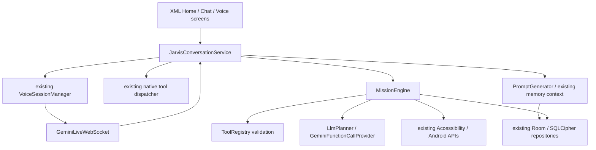

# Advanced assistant integration — verified repository map

Baseline: `f56bd1a`, main, inspected 2026-11-10. Remote main matched local before editing. Scope: Part 7 only. No Shizuku references found in the active source or Gradle configuration.

## Phase 1 integration status

Existing security is distributed across `security/sandbox/RiskPolicy`, permission checks, mission approvals, owner verification, and provenance/screen sanitization. It is not a single completed Phase 1 acceptance artifact. `MissionEngine` checks permissions, accessibility and approvals before side effects; its checkpoint/recovery logic preserves non-idempotent actions. `ExplicitMessageAuthorization` also recognizes bounded exact user commands. This is not blanket permission to send arbitrary model-generated messages. Full cross-entry-point policy verification remains open.

## Existing architecture and ownership

Live session reconnect ownership already exists; adding a second live session coordinator would duplicate it. Tool calls have per-connection duplicate-ID suppression and the service serializes execution with a mutex. Live PCM and transcripts already stream through the service. Native tool dispatch and mission tools use different declarations; consolidating schemas requires compatibility review rather than alias-only remapping (aliases can use different argument names). Existing REST provider abstractions and CognitiveRouter exist, but the generic provider is not the primary chat/voice owner. Chat is connected to the existing conversation service, not an independent REST chatbot.

## Remaining-work checklist

- Phase 2: shared capability-aware model discovery; remove execution reliance on unverified model IDs; preserve cancellation and JSON types; strict tool argument schemas; complete personality choices without changing authority; bounded multilingual context/follow-up regression coverage; reconcile native and mission contracts; verify actual API access when available.
- Phase 3: audit existing Vosk downloader/model manager, wake matcher, authoritative mic transitions, interruption/audio focus and screen-off lifecycle. Recognition accuracy requires real acoustic tests.
- Phase 4: audit current PhoneControlManager, contact selection, notifications, SMS, alarm/timer/reminder and device-control paths; enforce draft/approval/observable result semantics.
- Phase 5: audit semantic nodes, stale detection, transition waits, retry limits and approval boundaries in the existing accessibility/mission implementation.
- Phase 6: audit existing SQLCipher database, migrations, memory extraction, multilingual retrieval, corrections, export and deletion; preserve all stored data.
- Phase 7: audit existing mission planning, persisted checkpoints, replay prevention, approvals, observation verification and recovery.
- Phase 8: assess existing advanced controls. No raw AI-to-shell, privilege bypass, or new root/ADB connection will be enabled by default.
- Phase 9: build on existing real-time renderer and XML screens; audit actual state binding, fallback, reduced motion, dashboard and floating interface. No unsupported 3D-avatar claims.
- Phase 10: complete regression/lint/build/signature/artifact checks, release review and available emulator testing. Stable signing, installed-version upgrade preservation, real HyperOS behavior, acoustic quality and thermal/battery profiling remain explicit verification requirements.

## Phase 2 gaps established by source inspection

REST planner and provider use hardcoded model names; Live constructor rewrites some requested models based on string matching. None establishes current account availability. Registry validates presence but not parameter types. Generic Gemini provider converts all primitive function arguments to strings and uses a blocking uncancellable network call. Planner catches cancellation in its general exception handler. Existing personality options are incomplete and some prompt styles force English/Hinglish regardless of the configured language. These are the first compatible integration targets.

## Phase 2 implementation checkpoint

- `GeminiModelCatalog`: shared account-scoped ListModels discovery using existing OkHttp/cancellable request code, pagination bounds, ten-minute cache (eight account fingerprints maximum), method-filtered Live/text selection and task-specific Flash/Pro preference. User selection is honored only when advertised and compatible. No key in request URLs, logs or persistent discovery cache. Discovery does not certify model tool/image/input-audio support; server setup/request acceptance is still required.
- Existing Live service resolves an advertised Bidi model before connecting. Its cancellable bootstrap job is stopped with the session. The transport preserves that model instead of version-string rewriting or an unverified fallback after rejection.
- Existing planner and generic Gemini provider share discovery; planner cancellation propagates, generic Gemini HTTP uses the existing cancellable bounded response reader, and function arguments preserve native JSON types. Directive text requests and Aura text/search decisions use the same discovery. Image generation retains its separate explicit contract and is not incorrectly routed to a text-only fallback.
- `ToolArgumentValidator` rejects numeric/boolean string coercion, fractional/overflowing integers and non-finite numbers before mission execution. Live argument contracts are derived from the exact advertised declarations, with required/type/unknown-field checks before dispatch. Nested Live function calls now use the same duplicate-ID check as top-level calls; bounded deduplication survives reconnect.
- Provider session-resumption handles are held only in memory and cleared on account change/revocation; the transport requests resumption and consumes server updates. This is protocol integration, not proof that a particular model/account will accept resumption.
- Ten personality styles are selectable in the existing XML Persona screen. Legacy saved options remain readable. Style instructions respect configured language, non-human identity and authorization/privacy rules. The saved style is used when the existing session builds its next system instruction; immediate mid-session style changes are not claimed.
- Existing local-memory privacy boundary remains intact: `generateCurrentSystemPrompt` intentionally excludes stored personal memories/profiles/transcripts from cloud prompts. No memory data or database schema was changed. In-session Live conversation context stays with the provider during that session; full follow-up recovery still needs live acceptance tests and must not silently upload historical private data.

Phase 2 is not yet fully accepted: actual account/model discovery, Live setup/audio/resumption, multilingual multi-turn clarification, native/mission cross-route authorization and timeout behavior need end-to-end verification. Generic non-Gemini providers and the explicit image model contract are not claimed consolidated. Phases 3–10 are not marked completed on the basis of this checkpoint. No phase is accepted merely because its files exist.

First validation attempt failed at test compilation (missing `userName` fixture argument and source/test edits made while Gradle's source snapshot was being compiled). The argument was corrected and verification was restarted against a stable source snapshot. Only the final check results count as verification.

Verified checkpoint: `:app:testDebugUnitTest :app:lintDebug :app:compileDebugAndroidTestKotlin` completed successfully in 5m 47s (`work/advanced-phase2-final-validation.log`). JVM result: 466 tests, zero failures/errors, one existing environment skip. Instrumentation sources compiled; instrumentation was not executed in this checkpoint. No new APK, installation, device test or real cloud tool action is claimed. Parts 1–6 and repository workflows remain unchanged.

Follow-up transport verification: callbacks now check a connection epoch before changing state, consuming frames or applying resume handles. Late handshakes close their own socket; old failures/close callbacks cannot disconnect a replacement. The existing socket factory is injectable for deterministic no-network tests. The same Gradle checks passed in 5m 48s (`work/advanced-phase2-epoch-validation.log`): 468 JVM tests, zero failures/errors, one skip. Lint and instrumentation compilation passed; physical/API behavior remains unverified.

## Phase 3 preparatory source findings (not acceptance)

The active capture path is `JarvisConversationService` → `AudioPipelineManager(serviceScope, recorder)` → existing `AudioRecorder`; the manager's standalone AudioRecord branch is not used by that delegated path. Standby uses Vosk SpeechService and the service explicitly shuts it down before active conversation. `VoiceEnrollmentActivity` separately creates AudioRecord without coordinating with the conversation service in the inspected code: exclusivity needs a regression and shared ownership boundary before it can be claimed reliable.

WakeWordActivity schedules `audio/wake/ModelDownloadWorker`, which already checks free space, download/expanded-size bounds, archive paths, native Vosk initialization and a rollback installation. The older `audio/VoskModelDownloader` has SHA-256 support but no production caller found. The active worker restarts rather than resumes partial downloads and does not pin an independently verified model digest. Reuse/consolidate these paths in Phase 3; do not add another downloader or imply archive structure/native initialization is publisher authentication. Acoustic quality and screen-off behavior remain physical-device checks.

## Phase 3 independent ownership work

While Phase 2 cloud/device acceptance is blocked by unavailable account access and handset testing, a compatible independent repair adds a shared microphone lease to the existing capture paths. No recorder/service/recognition engine is duplicated. Active AudioRecorder and the manager's standalone fallback acquire VOICE_SESSION; existing Vosk SpeechService acquires WAKE_WORD; voice enrollment acquires VOICE_ENROLLMENT. Leases are identity-bound, so duplicate/old releases cannot clear a replacement owner. Enrollment capture replacement is serialized and cleanup runs on IO against its own local recorder. Busy/error states reset the enrollment controls and explain the blocker. Wake cleanup attempts each teardown operation separately and retains ownership if shutdown fails.

Core ownership checkpoint: unit tests, lint and instrumentation compilation passed in 5m 57s (`work/advanced-phase3-ownership-validation.log`). 471 JVM tests, zero failures/errors, one skip. No device execution is inferred. Further scan identified LocalDictation and EnglishTeacherActivity as additional microphone entry points requiring this same guard before whole-app microphone exclusivity is accepted.

Follow-up ownership integration adds LOCAL_DICTATION and LEARNING_SAMPLE to that same gate. Dictation releases its lease on results/errors/close and rejects callbacks from retired recognizers. Teacher recordings release their lease on finish/error/abort and ignore retired recording callbacks. AudioRecorder scope completion now releases its own hardware/lease, guarded by generation so an old completion cannot stop a replacement. Android regression coverage adds actual AudioRecord frame capture, competing-start rejection and scope-cancellation cleanup, plus wake-service owner assertions. These emulator checks are pending execution; captured silent frames would verify plumbing, not speech-recognition quality.

Further Phase 2 review found an account-selection inconsistency: service bootstrap discovers models with one key, but transport connect previously asked the rotating key provider again. Correcting the binding between a discovered model and the exact key used for its handshake is required before publication; key rotation must also rediscover capabilities for the newly selected account.

That inconsistency is now corrected: healthy reconnects retain their selected key. The existing VoiceSessionManager calls `connectDiscovered` inside its connection timeout, invalidating retired sockets and resolving capabilities for the exact queued/current key before opening its replacement. Quota rotation tests assert discovery precedes opening a socket for the alternate key. Unsupported models still fail rather than silently switching to an invented ID. The prompt's unmeasured sub-second latency mandate was replaced with a promptness instruction without a performance guarantee.

Final combined source verification: `:app:testDebugUnitTest :app:lintDebug :app:compileDebugAndroidTestKotlin` passed in 6m 3s (`work/advanced-brain-voice-final-validation.log`). 473 JVM tests, zero failures/errors, one existing environment skip. The 25 Android instrumented cases compile but their new-source execution remains pending. No new APK or release-candidate completion is claimed. Only Part 7 was changed; no dependencies, database migrations, user-data resets, Shizuku or privileged adapters were added.

## Source presence versus remaining acceptance

| Phase | Existing implementation reused | Remaining acceptance / missing work |
| --- | --- | --- |
| 2 | Conversation service, VoiceSessionManager, Live transport, planner, ToolRegistry, PromptGenerator, CognitiveRouter | Account-backed setup/resumption, multilingual multi-turn clarification, cross-entry authorization/timeout checks. Typed guards/model discovery/personality work described above is source-integrated. |
| 3 | AudioRecorder, delegated AudioPipelineManager, Vosk SpeechService/model manager, WakeMatcher, VoiceInterruptionCoordinator, existing player | Trusted model digest and resumable downloads, acoustic false-wake/barge-in tests, headsets/audio focus/phone calls, Android/OEM screen-off behavior; capture ownership integration is being verified. Some existing MediaRecorder preparation remains synchronous and requires performance review. |
| 4 | PhoneControlManager, MobileUtilityActions, DeviceActionDispatcher, ContactResolver, CallScreeningReceiver, NotificationListenerService/RemoteInput | Contact ambiguity and approvals across every entry point; real call/SMS/notification/utility verification. SMS composer is supported, not evidence of a sent SMS. Call answer/reject must remain unavailable unless a supported role/API is established. |
| 5 | JarvisAccessibilityService, ScreenGroundingEngine, SerializedActionExecutor, existing mission UI tools | Real multi-app transition/stale-node/retry/dialog tests; Android 16 HyperOS service connection persistence; prompt-injection and consequential-action boundaries across routes. |
| 6 | Existing Room/SQLCipher MemoryDatabase, MemoryRepository, chat/mission/history DAOs, migrations, memory export and vector providers | Multilingual retrieval/corrections/deletion/backup acceptance. Default deterministic local embeddings are not neural embeddings; do not label them as a verified neural model. Stored data remains untouched by current work. |
| 7 | MissionEngine, LlmPlanner, LongHorizonMissionCoordinator, PersistentMissionCheckpointStorage, mission approvals/history | Process-death/replay/duplicate-side-effect, recovery and mixed-tool workflow acceptance. A model completion claim is not execution evidence. |
| 8 | Android API/accessibility controls and existing diagnostics/sandbox | No dedicated wireless-ADB/root adapter located in the inspected active sources. No su/ADB/Shizuku control was introduced. Pairing, privileges, allowlists and device availability would need explicit capability-specific verification. |
| 9 | XML/ViewBinding screens, live WebView orb, avatar/overlay/task progress, theme controls | Requested navy/cyan visual direction, functional dashboard/navigation, lightweight fallback/reduced-motion and device performance acceptance; not implemented by changing personality settings. |
| 10 | Existing Gradle, unit/instrumentation suites, lint, CI, signing hooks | Full end-to-end/upgrade/data-preservation checks, stable private signing setup, R8/release review, physical device/performance tests and final release-candidate APK. Earlier CI APK is not evidence for this source checkpoint. |

The latest extended capture check passed JVM tests but failed lint on LocalDictation indentation. The formatting is corrected without suppressing lint. Final combined verification is being rerun; the failed run is not counted as a passing checkpoint.

## CI trigger repair requested after the source checkpoint

Branch `feature/advanced-brain-voice-2026-11-10` holds verified progress while Android runtime acceptance is pending; GitHub main remains unchanged. CLI workflow dispatch failed because the cloud proxy rejected the CONNECT tunnel to api.github.com (403); the connected GitHub tools do not expose workflow dispatch. The user then explicitly requested fixing CI rather than a manual run.

The narrow infrastructure exception for that request changes only `.github/workflows/android-runtime.yml`: trusted feature-branch pushes now run the existing Android 16 runtime job automatically, relevant Part 7 code/build changes trigger verification, and concurrency is per ref so a feature branch cannot cancel main's run. No API credential, permission expansion, third-party action, new deployment or test bypass is added. App changes remain within Part 7 and Parts 1–6 remain untouched. Final Android execution results must still be recorded after the workflow actually runs.

The push trigger worked: [run 42827889742](https://github.com/levinhocall/Jarvis-os/actions/runs/42827889742), source `e51e24f`, executed 25 Android 16 emulator tests. 24 passed; wake-stop owner assertion failed with `expected null, but was WAKE_WORD`. Real AudioRecord frame capture/competing-start rejection/scope-cancellation cleanup passed (1.521s). Inspection shows standby-off and capture-off were published before synchronous Vosk shutdown released the lease. Production stop-state publication must follow cleanup; the assertion remains enabled. This failed run is retained as evidence, not counted as a passing release check.

## Phase 4 independent draft-safety repair

Source audit found `handleDisambiguationChoice` fell back to the first contact for arbitrary input and substituted `Hello` when the original message was unavailable. A new ambiguous request could also leave an earlier send-ready draft active, which `sendMessageDirectly` could then consume. The existing assistant now clears obsolete send-ready drafts, retains the original ambiguous-request message, requires a unique explicit name/word/ordinal choice, preserves a recipient while asking for its missing message, and clears all pending choice state on cancellation. A call/delete choice cannot become a message draft. No real message or phone call is executed by these tests.

`ContactLookup` is a small fakeable boundary implemented by the existing ContactResolver, not a second contacts engine. ContactChoiceResolver uses Unicode words and supports English/Hinglish/Hindi ordinals without first-contact fallback. Tests cover wrong/duplicate/partial choices, duplicate display names with different numbers, stale drafts, preserved message content, missing-message follow-up and cancellation. This does not certify all contact fuzzy matching, country-code normalization, call/SMS role support or live WhatsApp delivery.

Draft-safety checkpoint: unit suite, lint and instrumentation compilation passed in 5m 53s (`work/advanced-phase4-draft-validation.log`). 480 JVM tests, zero failures/errors, one skip: host-development environment detection in DevEnvironmentAndTermuxBridgeTest. Android execution of this updated snapshot remains pending.

Wake-stop production correction: a stopping flag prevents wake callbacks/new capture during teardown; successful capture-off and standby-off publication now follows Vosk shutdown and microphone-lease release. Failure continues to retain ownership and an actionable diagnostic. The original failed native owner assertion remains unchanged. This verification-branch correction is pending fresh local checks and the automatically triggered Android runtime rerun; main has not been merged.

Wake-stop verification completed: local unit/lint/instrumentation compilation passed in 5m 58s (`work/advanced-wake-stop-final-validation.log`, 480 JVM tests, zero failures/errors, one skip). [Android 16 run 42829682579](https://github.com/levinhocall/Jarvis-os/actions/runs/42829682579), source `74dce4a`, passed all 25 instrumented tests, zero failures/errors/skips. The unchanged wake-stop assertion passed (2.722s), and real AudioRecord exclusivity/scope-cancellation passed (1.043s). This establishes emulator runtime evidence, not physical acoustic/HyperOS validation or Gemini API acceptance.

## Phase 5 independent cancellation repair

The existing SerializedActionExecutor invalidated queued generations but did not cancel its already-running coroutine. It now registers the active action job under a short lifecycle lock and cancels that exact job when a task stops or is replaced. Retired-job cleanup cannot clear a replacement. The existing mutex still serializes mutations; its wait now consumes the same tool deadline instead of silently extending it. Logs retain only known action categories and error classes, not caller-supplied screen labels or exception text.

Tests cover active cancellation preventing later fake steps, replacement rejecting old queued work, and a deadline expiring while another action owns the mutex. Unit/lint/instrumentation compilation passed in 6m 1s (`work/advanced-phase5-cancellation-validation.log`); no extra Android-device execution is inferred for this new executor snapshot. Android operations already handed to the system cannot be undone by coroutine cancellation; blocking SDK calls remain cooperative boundaries. Full multi-app automation acceptance remains open.

The Phase 5 JVM count is 483, zero failures/errors and one existing host-environment skip.

## Phase 6 multilingual recall and correction integrity

Source inspection established ASCII-only tokenization in the dense local provider and keyword fallback, plus removal of Devanagari combining marks in episodic recall. A shared Unicode/NFKC tokenizer now preserves letters, marks and numbers with locale-independent case folding and canonical joiner handling. Local hashing uses code-point n-grams. This is on-device heuristic retrieval, **not a pretrained neural embedding model or proof of cross-language semantic equivalence**.

The derived model identifier is versioned `local-unicode-v2-l2-<dimension>`. The existing repository lazily rebuilds stale vectors in bounded batches of 24 on device. Until rebuilt, an incompatible model/dimension uses keyword fallback rather than comparing unrelated embedding spaces. Non-finite corrupt vectors also fall back to keywords. Original stored facts, IDs, encrypted database and schema remain intact; no memory is sent to a remote embedding service.

Slow re-index/correction work previously wrote results without checking whether the user had changed or deleted the row meanwhile. Existing Room DAO transactions now compare the captured row before updating a derived vector or corrected fact. The MemoryActivity edit dialog uses that correction path on IO, refreshes the representation and reports conflicts instead of falsely announcing an update. The editor also checks its original snapshot, so an old dialog cannot silently replace newer data.

New JVM tests cover Hindi vowel signs/canonical forms, Hindi/Hinglish/English finite local vectors, Hindi keyword recall for unindexed rows, rejection of incompatible same-size vectors, corrupt-vector fallback, stale editors/indexers and deletion protection. A new Android Room regression checks late index rejection and deletion during a suspended correction. Unit/lint/instrumentation compilation passed in 6m 38s (`work/advanced-phase6-memory-validation.log`): 489 JVM tests, zero failures/errors, one existing skip. The updated 26-case Android suite is compiled but not yet executed. Actual neural models, cross-language translation-quality recall, real-device upgrade preservation and full memory-extraction/retention acceptance remain open.

[Android 16 run 42834699475](https://github.com/levinhocall/Jarvis-os/actions/runs/42834699475), source `6a1a7ab`, subsequently passed 26/26 instrumented tests, zero failures/errors/skips. The new late-index/deletion-during-correction Room regression passed (0.029s); the original migration, cipher, conversation and microphone tests remain enabled. Source `6a1a7ab` includes Phase 5 cancellation and Phase 6 changes; later snapshots need their own verification.

## Phase 7 mission recovery and duplicate-action identity

Audit confirms the existing engine saves the in-flight checkpoint before attempting an action and blocks execution when persistence fails. It suppresses automatic retry after a consequential/possibly-mutating unverified outcome, records incomplete verification separately, and restores interrupted non-idempotent steps for manual review rather than replay. These implementations are retained.

The consequential cooldown previously keyed actions using map.toString(), allowing field order to change the same invocation's identity. MissionActionIdentity now canonicalizes object keys, preserves array/message/type differences, normalizes equivalent numbers and aliases, rejects unbounded/non-JSON values, and hashes the payload instead of storing new raw message/contact strings in dedup keys. Exact legacy persisted keys remain honored during the transition. Unsafe identity construction blocks execution. This identifies a typed invocation, not all possible name aliases resolving to the same human.

Unit/lint/instrumentation compilation passed in 5m 58s (`work/advanced-phase7-identity-validation.log`): 494 JVM tests, zero failures/errors, one skip. Further schema hardening must reject ignored extra arguments so a nonce cannot evade the invocation identity; the actually-supported optional WhatsApp app_number must first be represented in its registry declaration. No phase-wide real-app mission completion is claimed from these pure tests.
