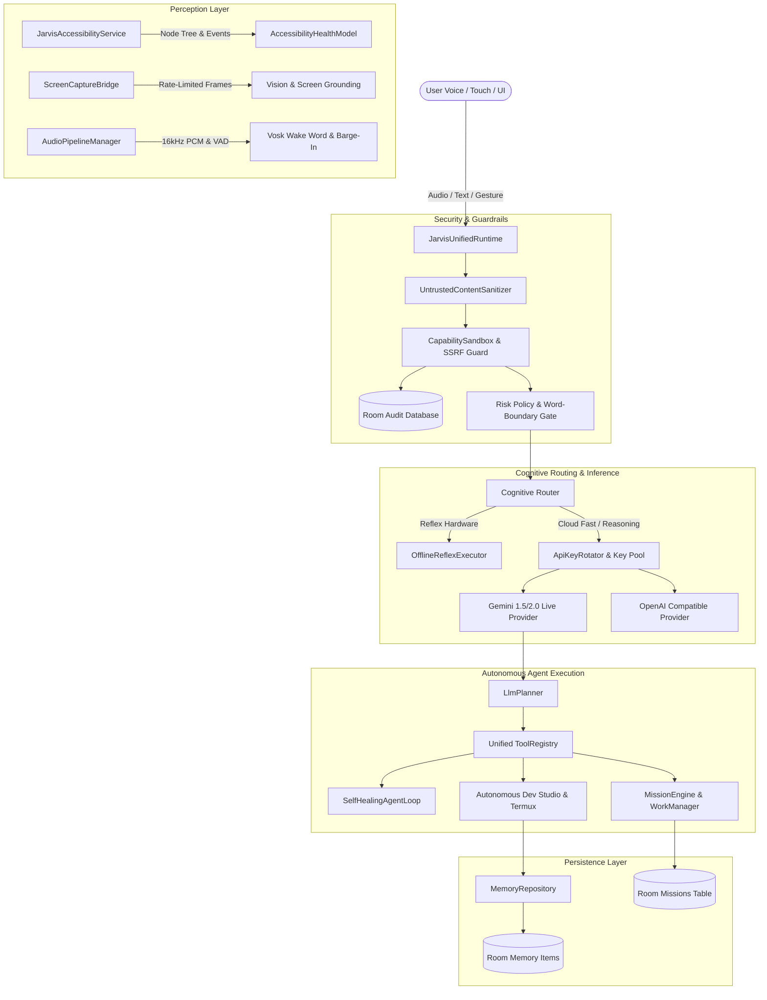
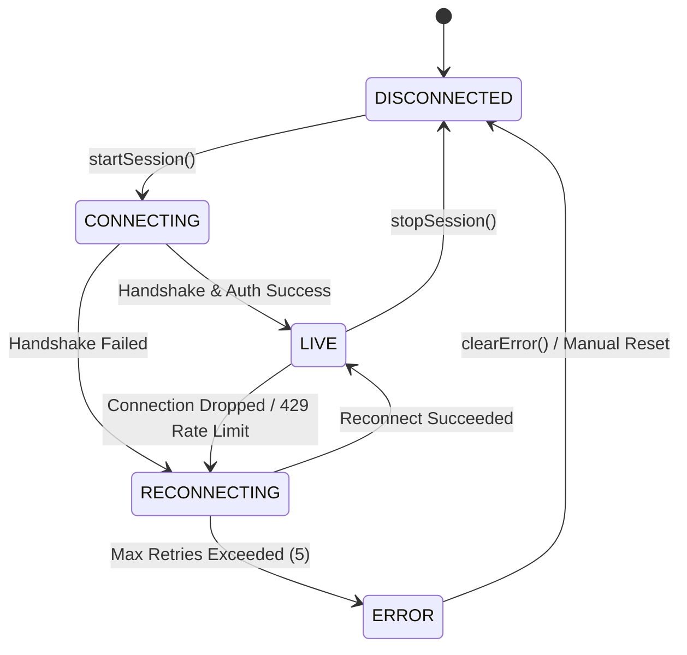
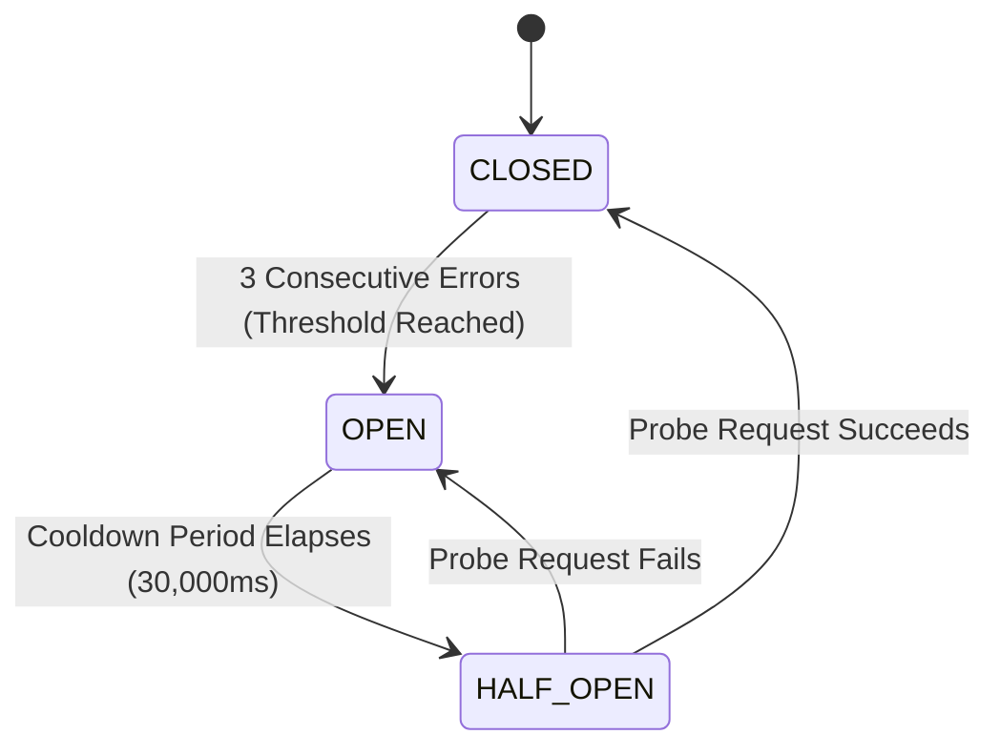
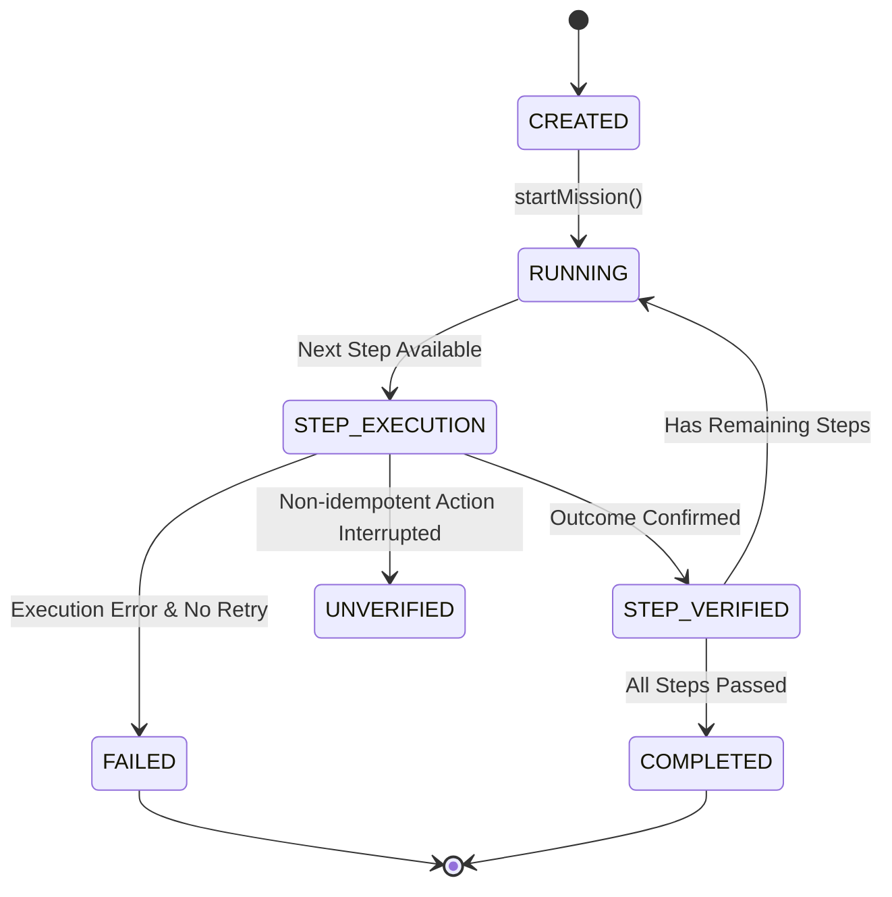

# JARVIS OS — Autonomous Agent & Cognitive System Architecture

## 1. High-Level System Architecture

---

## 2. Component Catalog

| Component | Responsibility | Dependencies | Threading Model | Failure Mode |
| :--- | :--- | :--- | :--- | :--- |
| **`JarvisUnifiedRuntime`** | Central orchestrator for request ingress, boot self-tests, and routing. | `CapabilitySandbox`, `CognitiveRouter`, `MissionEngine` | `Dispatchers.Default` | Returns safe fallback or security violation diagnostic. |
| **`VoiceSessionManager`** | Manages WebSocket live session, reconnect backoff, and heartbeat. | OkHttp WebSocket, Coroutines | `Dispatchers.IO` | Exponential backoff (max 5 attempts), transitions to `ERROR`. |
| **`AudioPipelineManager`** | Low-latency 16kHz PCM capture, hardware AEC, and loudspeaker barge-in. | `AudioRecord`, `AcousticEchoCanceler` | Dedicated IO thread | Graceful audio device fallback, zeroed frame keepalive. |
| **`ScreenCaptureBridge`** | Rate-limited frame capture (JPEG quality 65%) with MediaProjection. | `MediaProjection`, `ScreenCaptureManager` | Asynchronous handler | Skips frames if rate limit (< 800ms) or drops gracefully. |
| **`DeviceActionDispatcher`** | Dispatches hardware controls, phone calls, volume, and app intents. | Android Framework Services | Main / IO dispatch | Reports structured failure or missing permission. |
| **`CognitiveRouter`** | Classifies taxonomy, enforces on-device privacy tier, tracks EMA latency. | ConcurrentHashMap, ProviderHealth | Thread-safe synchronized | Fails over through configured provider chain to local reflex. |
| **`ApiKeyRotator`** | Round-robin key rotation with 429 exponential backoff cooldown. | Gson, SecureSharedPreferences | Thread-safe synchronized | Skips rate-limited keys; uses fallback primary key. |
| **`AutonomousDevLoop`** | Executes 6-phase engineering tasks (Inspect, Plan, Execute, Test, Verify, Report). | `SoftwareEngineeringAgent`, `TermuxBridge`, `MemoryRepository` | `Dispatchers.IO` | Rollback on test failure, reports non-zero exit codes. |
| **`MissionEngine`** | Long-horizon multi-step mission orchestrator with step-level persistence. | Room `MissionDao`, WorkManager | `Dispatchers.IO` | Suspends non-idempotent steps as `UNVERIFIED` across reboots. |
| **`CapabilitySandbox`** | SSRF prevention (DNS resolution, private IP ranges) and path traversal checks. | `AuditDatabase`, java.nio.file.Path | IO / Default | Blocks malicious directives and logs cryptographic tamper-evident record. |

---

## 3. State Transition Diagrams

### 3.1 Voice Session Lifecycle

### 3.2 Circuit Breaker State Machine

### 3.3 Mission Execution Lifecycle

---

## 4. Security & Sandbox Boundary Model

### 4.1 SSRF & Network Security Gates
Any URL or network request generated by an agent must pass `CapabilitySandbox.validateUrl()`:
1. **IP Literal & Encoding Defense**: Resolves decimal integers (e.g. `2130706433`), hex addresses, and octal notations.
2. **DNS Pre-flight Resolution**: Resolves all `InetAddress` records to verify no private, link-local, loopback, or cloud metadata endpoints (`169.254.169.254`, `10.0.0.0/8`, `172.16.0.0/12`, `192.168.0.0/16`, `fc00::/7`, `fe80::/10`) are targeted.
3. **Redirect Hop Tracking**: Manually enforces a strict 5-hop redirect limit with full re-validation at each hop to eliminate DNS rebinding attacks.

### 4.2 Workspace Path Traversal Defense
File access is constrained via canonical `Path.startsWith` component matching:
- Prevents substring escape attacks (e.g. `/data/app` vs `/data/app2`).
- Blocks access to Android protected system directories (`/proc`, `/sys`, `/dev`, `/system`, `/etc`, `/data/system`).

### 4.3 Destructive Git Operation Auditing
Commands like `git push -f`, `git branch -D`, `git reset --hard`, and `git clean -fd` are intercepted by `SoftwareEngineeringAgent.auditGitOperation()`:
- Automatically halts automated execution.
- Generates a user-facing authorization dialog before execution.
